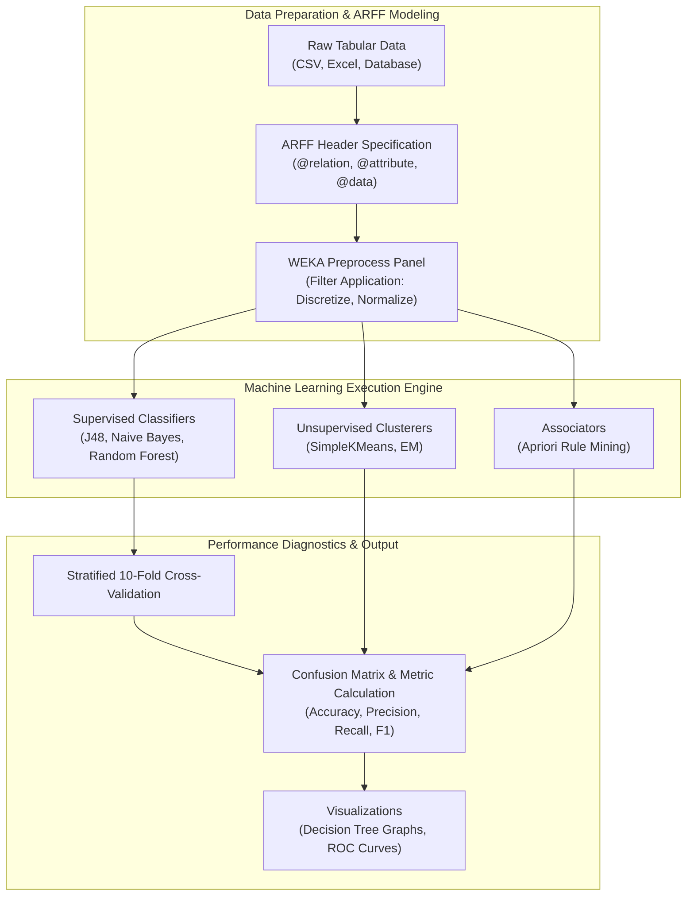

<div align="center">


[](https://waikato.github.io/weka-wiki/)
[](https://www.oracle.com/java/)
[](#)
[](#)
[](#)

</div>

---

## 📌 Executive Summary & Overview

Data mining involves discovering novel, valid, potentially useful, and understandable patterns in massive data collections. Before applying machine learning algorithms, raw datasets must undergo systematic preprocessing, discretization, noise filtering, and format standardization.

The **WEKA Data Mining Lab** repository provides a laboratory environment for the **Waikato Environment for Knowledge Analysis (WEKA)** suite. It covers end-to-end data mining experiments spanning:
1. **Attribute-Relation File Format (ARFF)** dataset creation, verification, and transformation.
2. **Supervised Classification:** Benchmarking decision trees (J48 / C4.5), Naive Bayes, Random Forests, and lazy classifiers (k-Nearest Neighbors / IBk).
3. **Unsupervised Clustering:** Partitioning data spaces using SimpleKMeans and Expectation Maximization (EM).
4. **Association Rule Discovery:** Mining frequent itemsets and co-occurrence rules via the Apriori algorithm.
5. **Rigorous Model Evaluation:** 10-fold cross-validation, confusion matrix auditing, precision/recall trade-offs, and Receiver Operating Characteristic (ROC) curve analysis.

---

## 📑 Interactive Table of Contents

- [📌 Executive Summary & Overview](#-executive-summary--overview)
- [✨ Key Features & Empirical Capabilities](#-key-features--empirical-capabilities)
- [📊 Algorithmic Taxonomy & Workflows](#-algorithmic-taxonomy--workflows)
- [🏗 System Architecture & Mining Pipeline](#-system-architecture--mining-pipeline)
- [🛠 Tech Stack Breakdown](#-tech-stack-breakdown)
- [🚀 Reproducible Quickstart & Setup](#-reproducible-quickstart--setup)
- [📂 Project Directory Layout](#-project-directory-layout)
- [👨‍💻 Author & Contributions](#-author--contributions)

---

## ✨ Key Features & Empirical Capabilities

- **🧹 Preprocessing & Attribute Engineering:**
  - Automated missing value imputation via `ReplaceMissingValues` filters.
  - Continuous-to-nominal discretization with `Discretize` for decision tree splits.
  - Min-Max and Z-Score feature scaling using `Normalize` and `Standardize`.
- **🌳 Supervised Classification Benchmarks:**
  - **J48 Decision Tree:** Entropy reduction and Information Gain Ratio evaluation with pruning parameters.
  - **Naive Bayes:** Probabilistic classification assuming conditional attribute independence.
  - **Random Forest:** Ensemble bagging over multiple decision stumps to prevent overfitting.
- **🔍 Unsupervised Cluster Analysis:**
  - **k-Means:** Iterative centroid assignment minimizing intra-cluster squared Euclidean distance.
- **🛒 Association Rule Mining:**
  - **Apriori Algorithm:** Evaluating transaction datasets using minimum support and minimum confidence thresholds.
- **📈 Comprehensive Diagnostic Metrics:**
  - Stratified 10-Fold Cross-Validation to prevent sample bias.
  - Precision, Recall, F-Measure, Cohen's Kappa statistic, and ROC Area (AUC) metric calculations.

---

## 📊 Algorithmic Taxonomy & Workflows

| Task Type | WEKA Class / Module | Algorithm | Evaluation Focus |
| :--- | :--- | :--- | :--- |
| **Classification** | `weka.classifiers.trees.J48` | C4.5 Decision Tree | Tree depth, pruned error rate, confusion matrix |
| **Classification** | `weka.classifiers.bayes.NaiveBayes` | Naive Bayes Classifier | Prior/posterior probabilities, Laplace estimator |
| **Clustering** | `weka.clusterers.SimpleKMeans` | k-Means Partitioning | Within-cluster sum of squared errors, iterations |
| **Association** | `weka.associations.Apriori` | Apriori Mining | Support, confidence, lift, leverage thresholds |
| **Filtering** | `weka.filters.unsupervised.attribute.*` | Discretize / Normalize | Bin count, variance stabilization, distribution shape |

---

## 🏗 System Architecture & Mining Pipeline

The following architectural flowchart outlines the end-to-end data mining execution loop in WEKA:



---

## 🛠 Tech Stack Breakdown

| Category | Component | Specification |
| :--- | :--- | :--- |
| **Data Mining Platform** | WEKA Workbench | Version 3.8+ (Explorer, Experimenter, KnowledgeFlow, CLI) |
| **Runtime Environment** | Java Virtual Machine (JVM) | OpenJDK 11+ / Oracle Java 8+ |
| **Dataset Format** | ARFF (Attribute-Relation File Format) | Plaintext metadata-driven format with typed headers |
| **Command-Line Interface** | WEKA CLI | Headless execution for batch experiments and automation |
| **Documentation** | Markdown / Scientific Reports | Methodology, evaluation metrics, and analysis summaries |

---

## 🚀 Reproducible Quickstart & Setup

### Prerequisites
- Java Runtime Environment (JRE) or Java Development Kit (JDK 11+)
- WEKA 3.8+ ([Download from official repository](https://waikato.github.io/weka-wiki/downloading_weka/))

### Step-by-Step Execution
```bash
# 1. Clone this repository
git clone https://github.com/akashvenkey/WEKA.git

# 2. Navigate into project directory
cd WEKA

# 3. Running J48 Decision Tree from Command Line (example on iris.arff):
java -cp "C:\Program Files\Weka-3-8\weka.jar" weka.classifiers.trees.J48 -t "C:\Program Files\Weka-3-8\data\iris.arff" -x 10

# 4. Running Apriori Association Rules from Command Line:
java -cp "C:\Program Files\Weka-3-8\weka.jar" weka.associations.Apriori -t "C:\Program Files\Weka-3-8\data\weather.nominal.arff" -N 10 -C 0.9
```

### Using the WEKA Explorer GUI
1. Launch WEKA and select the **Explorer** interface.
2. In the **Preprocess** tab, load your target `.arff` file.
3. Switch to the **Classify** tab, click **Choose**, select `trees -> J48`, and click **Start**.
4. Right-click the result list entry to select **Visualize tree** or **Visualize classifier errors**.

---

## 📂 Project Directory Layout

```plaintext
WEKA/
├── datasets/          # Standard and custom ARFF data files
├── experiments/       # Preprocessing filter scripts and test configurations
├── results/           # Confusion matrices, tree visualizations, and benchmark logs
└── README.md          # Comprehensive data mining laboratory guide
```

---

## 👨‍💻 Author & Contributions

**Akash V**  
- **GitHub:** [@akashvenkey](https://github.com/akashvenkey)  
- **Discipline:** Data Mining, Machine Learning & Knowledge Discovery  
- **Academic Program:** BCA (Hons), Alliance University, Bangalore  

Contributions of new ARFF datasets, experimental scripts, and classification comparisons are welcome. If this lab blueprint aids your studies, please give it a ⭐!

---

<div align="center">


</div>